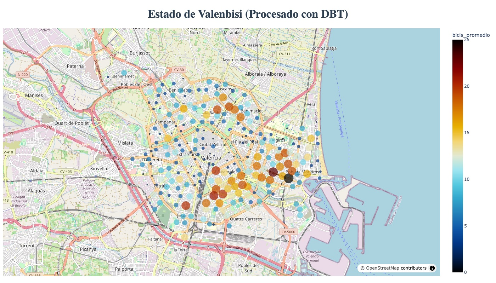
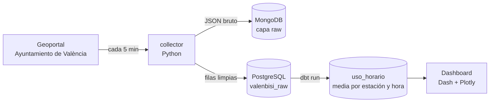

# 🚲 Valenbisi Data Pipeline


Pipeline de datos en tiempo real sobre **Valenbisi**, el servicio de bicicleta compartida de Valencia. Cada 5 minutos descarga el estado de las **273 estaciones** desde el Geoportal del Ayuntamiento, guarda el dato bruto en **MongoDB** y el dato estructurado en **PostgreSQL**, lo transforma con **dbt** y lo muestra en un **mapa interactivo** que se actualiza solo.

Todo arranca con un único `docker compose up`.



---

## Arquitectura



| Servicio | Tecnología | Qué hace |
| --- | --- | --- |
| `collector` | Python, requests | Descarga las estaciones cada 5 minutos y escribe en las dos bases de datos |
| `mongodb` | MongoDB | Conserva la respuesta original de la API, por si hay que reprocesar |
| `db` | PostgreSQL 15 | Guarda una fila por estación y lectura, con coordenadas, bicis y anclajes libres |
| `transform` | dbt-postgres | Agrega la ocupación media por estación y hora (`uso_horario`) y la valida con tests |
| `dashboard` | Dash, Plotly | Mapa de Valencia con el estado de cada estación; se refresca cada 30 s |

### Por qué dos bases de datos

MongoDB guarda el JSON tal y como llega: si la fuente cambia de formato (ya ha pasado: el portal de datos abiertos se trasladó al Geoportal y cambió la estructura del JSON), el histórico se puede reprocesar sin perder nada. PostgreSQL guarda solo lo necesario en un esquema fijo, que es lo que necesita dbt para modelar y el dashboard para consultar rápido.

---

## Cómo ejecutarlo

Requisito: Docker Desktop.

```bash
git clone https://github.com/RicardoEdreiraPenas/valenbisi-data-pipeline.git
cd valenbisi-data-pipeline
cp .env.example .env
```

Edita `.env` y pon una contraseña para PostgreSQL y otra para MongoDB. Puedes generarlas con `openssl rand -base64 24`. Si falta alguna, `docker compose` no arranca y dice qué variable falta.

```bash
docker compose up --build
```

| Servicio | Dirección |
| --- | --- |
| Dashboard | http://127.0.0.1:8050 |
| PostgreSQL | 127.0.0.1:5432 (usuario `postgres`) |
| MongoDB | 127.0.0.1:27017 (usuario de `MONGO_USER`) |

El collector espera unos segundos a que las bases de datos estén listas y empieza a descargar. Para actualizar la capa transformada con los datos nuevos:

```bash
docker compose run --rm transform          # dbt run
docker compose run --rm --entrypoint dbt transform test
```

## Seguridad

- No hay contraseñas por defecto. Se leen de `.env`, que está en `.gitignore`; si faltan, `docker compose` no arranca y el colector y el dashboard se detienen con un mensaje que dice qué variable falta.
- MongoDB funciona con autenticación: el usuario administrador se crea en el primer arranque a partir de `MONGO_USER` y `MONGO_PASSWORD`.
- Los puertos se publican solo en `127.0.0.1`, así que las bases de datos y el dashboard no son accesibles desde otros equipos de la red.
- Las imágenes de Docker y las dependencias de Python tienen la versión fijada, y Dependabot revisa cada semana si hay actualizaciones.

Si ya tenías el proyecto en marcha con la configuración anterior, MongoDB solo crea el usuario cuando el volumen está vacío. Para empezar de cero (se borran los datos guardados):

```bash
docker compose down -v
```

## Modelo dbt

`uso_horario` agrupa las lecturas por estación y hora y calcula la media de bicicletas disponibles y de anclajes libres. Incluye tests de `not_null` sobre la estación y la hora.

## Estructura

```
├── collector/        Descarga desde la API y escritura en MongoDB y PostgreSQL
├── db/init.sql       Tabla de lecturas en PostgreSQL
├── transform/        Proyecto dbt (modelo uso_horario y sus tests)
├── dashboard/        Mapa interactivo con Dash y Plotly
└── docker-compose.yml
```

## Datos

Fuente: [ValenBisi Disponibilidad](https://opendata.vlci.valencia.es/dataset/valenbisi-disponibilitat-valenbisi-dsiponibilidad), portal de datos abiertos del Ayuntamiento de València. El colector consulta su servicio del Geoportal, que devuelve todas las estaciones en GeoJSON. Las horas se guardan en hora local de València.

## Autor

**Ricardo Edreira Penas** · Data Analyst · Data Engineer Junior
[LinkedIn](https://www.linkedin.com/in/ricardoedreira) · [GitHub](https://github.com/RicardoEdreiraPenas)
